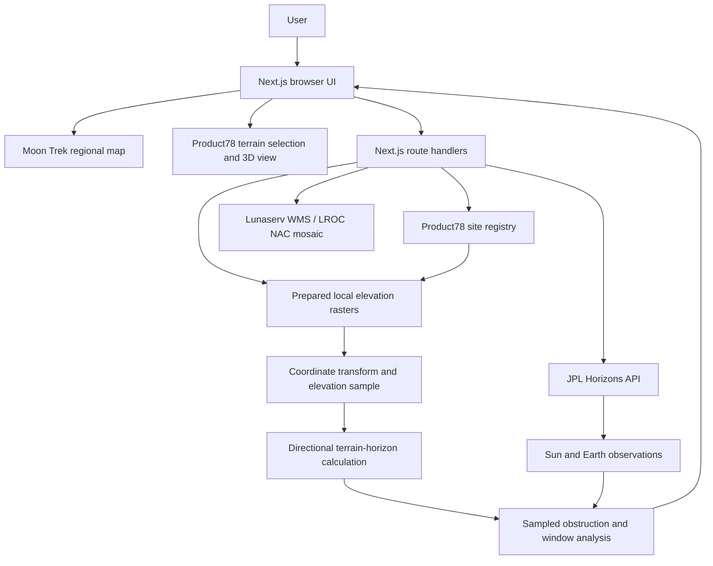

# Lunex system architecture

## 1. Overview

Lunex is a full-stack Next.js application. The browser provides lunar map selection, terrain visualization, candidate comparison, and mission timelines. Server-side route handlers read prepared terrain files, validate the selected observer position, query NASA/JPL Horizons, and combine the resulting ephemerides with a sampled terrain horizon.

## 2. Frontend

The interface is implemented in the Next.js App Router and uses React/TypeScript.

| Area | Responsibility |
|---|---|
| Home route | Product introduction and global lunar orientation |
| Map route | South-polar basemap, candidate selection, and selected-position workflow |
| Mission data route | Detailed time-based analysis and joint visibility planning |
| Science route | Compare registered candidate sites with available local assets |
| Explorer route | Interactive 3D lunar terrain and selected-pixel inspection |
| Terrain diagnostic routes | Development checks and terrain validation views |

The map component loads the NASA Moon Trek south-pole LRO WAC tile service for regional context. The higher-resolution local terrain view uses the prepared Product78 raster. These sources have distinct roles: the regional image is map context; the DEM is the numerical elevation input.

Three.js, React Three Fiber, and Drei support the 3D view. OpenLayers and proj4 support projected map coordinates.

## 3. API layer

The server routes are implemented with Next.js route handlers. Important routes include:

- `/api/product78/sites`: catalogue and per-site local asset inspection.
- `/api/horizons`: daily reference-observer ephemerides and terrain assessment.
- `/api/horizons/selected-location`: selected-position time series.
- `/api/horizons/mission-analysis`: single-epoch, joint-day, and visibility-cycle calculations.
- `/api/product78/terrain-preview`: reduced binary DEM for fast visualization.
- `/api/product78/science-sample`: one-pixel science sample.
- `/api/lunar-imagery/nac-south-pole`: optional LROC imagery proxy.
- `/terrain-selection`: coordinate validation and elevation sample.

The API uses local filesystem reads and outbound HTTPS. It therefore requires a Node.js-compatible server runtime; it is not a static-only website.

## 4. Terrain data pipeline

### Site registry

`src/components/lib/lunar/siteRegistry.ts` holds 27 Product78 candidate entries, reference coordinates, archive identifiers, and data-directory names. A registered candidate can have no local raster; the API reports readiness separately.

### Preparation

`scripts/prepare-product78-sites.mjs` downloads selected NASA Product78 source GeoTIFFs to a temporary directory, validates the input structure/georeferencing, and writes a local metadata file plus Float32 elevation binary. The preparation script removes the temporary source file after processing.

### Runtime loading and validation

`terrainData.ts` decodes the prepared raster and validates the expected projection/reference metadata, dimensions, data type, byte order, and file length. The coordinate helper maps the selected geographic observer into projected raster coordinates and a pixel index.

### Terrain horizon

The server samples terrain along bearings around the selected observer. A direction terminates at the available data boundary, NoData, or configured search limit. The algorithm keeps sample coverage/termination metadata and does not infer terrain beyond the known coverage.

The normal Product78 baseline is kept separate from optional Product90 regional enhancement. Product90 cannot be a prerequisite for returning the valid Product78-only result.

## 5. Ephemeris and mission analysis

The server requests Horizons observer tables for the Sun (10) and Earth (399), as seen from the lunar surface observer at `coord@301`. The API requests apparent airless azimuth/elevation and target angular diameter.

The application compares the celestial position with the terrain-horizon estimate at the corresponding azimuth. For target-disk screening, it estimates upper/lower limb clearance from angular diameter. This is a first-order vertical limb check at the target-centre azimuth, not full two-dimensional occultation.

The mission-analysis route supports:
1. A single UTC observation.
2. A UTC-day joint Sun/Earth assessment.
3. An automatic visibility-cycle search for a requested duration.

Sun/Earth samples are paired by epoch, with a configured timestamp tolerance. Missing observation samples break windows instead of being treated as continuous visibility.

## 6. Optional imagery and science layers

- Moon Trek supplies regional map imagery.
- LROC controlled NAC mosaic imagery is requested through Lunaserv WMS and is used as an optional texture only.
- Product78 ancillary layers are represented in Site04 metadata, but the required four local science binaries were absent from the reviewed repository snapshot. The science-sample endpoint must be verified after those files are packaged.
- Product90 sampling is optional and must remain clearly distinguished from the standard Product78 terrain path.

## 7. Deployment topology

The browser currently calls relative `/api/...` paths. The recommended topology is a single public origin serving the Next.js UI and its API routes. A separate frontend/API deployment requires an explicit reverse proxy or rewrite and client API-base configuration; do not assume cross-origin API routing is already implemented.

The server requires:
- Node.js runtime support.
- Local prepared terrain assets available to the route handlers.
- Outbound HTTPS to JPL Horizons and, when used, Moon Trek/Lunaserv.
- Execution time/memory appropriate for raster reads, caching, and terrain calculations.
- Correct file tracing or static-asset inclusion for the binary rasters in the deployment platform.

## 8. Known architectural boundaries

Lunex does not currently calculate:
- Certified safe landing zones or a hazard probability model.
- Full global 360° horizon coverage outside the local prepared DEM.
- Full 2D target-disk/terrain intersection.
- Solar-array energy/power generation, thermal behavior, or energy-storage sizing.
- RF link budgets, antenna pointing/gain, power, frequency, data rate, or communications margin.

These exclusions should remain visible in the UI and project narrative. They prevent a geometric screening tool from being misrepresented as a complete mission certification system.
